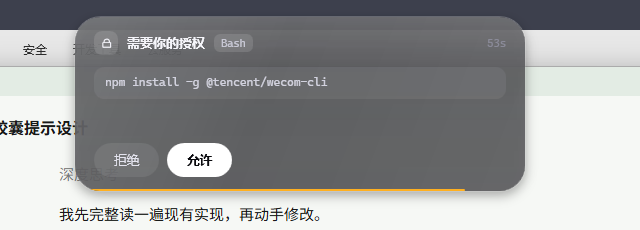
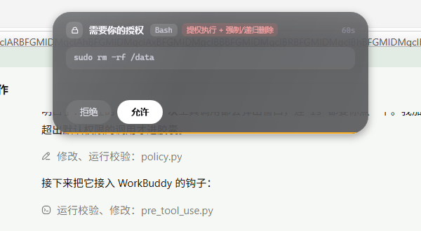
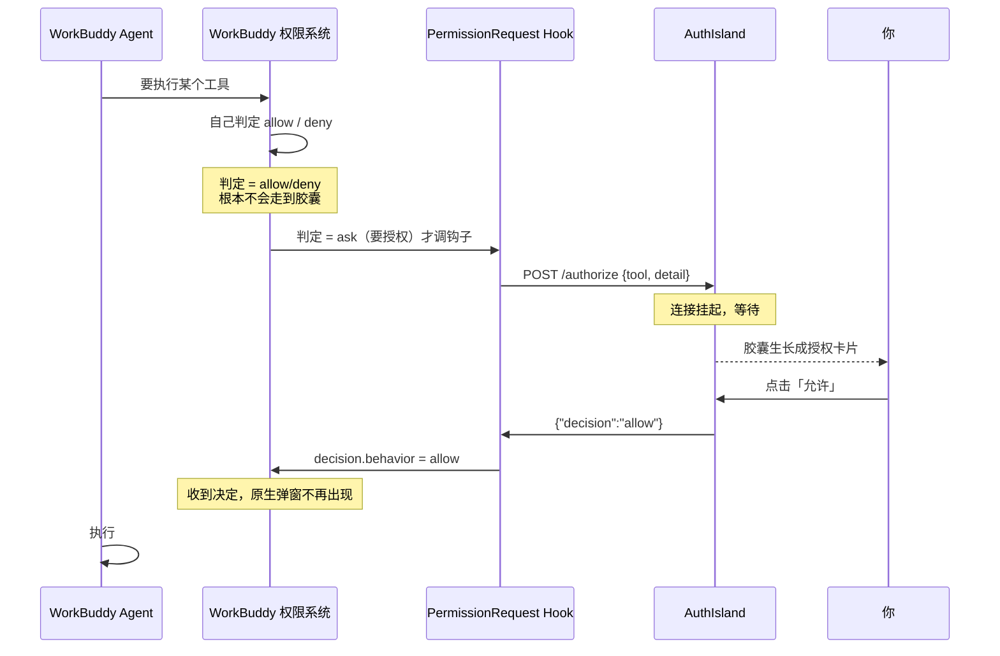

# AuthIsland

给 AI Agent 用的**授权灵动岛**。屏幕上沿一颗黑色胶囊，Agent 需要授权时自动生长成卡片，
列出「哪个工具、要执行什么」，点「允许 / 拒绝」直接把决定回传给 Agent。

Windows 11 · 原生 WPF (.NET 8) · 无 Electron / 无 WebView。





## 拦截颗粒度：宿主说了算

胶囊不做任何「该不该弹」的判断。WorkBuddy 的权限系统判定一次工具调用需要授权
（它自己的沙箱规则 / 权限设置说「ask」）时，才会通过 `PermissionRequest` 钩子
把请求同步到胶囊——所以胶囊的颗粒度永远和你设置的权限规则一致。
胶囊没开 / 超时 / 你不点，WorkBuddy 会退回它自己的原生审批弹窗，不会卡住。

## 一键安装（推荐，任何 WorkBuddy 用户可用）

从 [Releases](https://github.com/yfddxwx/hook-body/releases/latest) 下载 `AuthIsland.exe`
（单文件，69MB，自带 .NET 运行时）后：

1. **双击它** → 点「一键安装」
2. 完成。胶囊已在屏幕顶部待命。

安装器会自动做完所有杂事：

- 复制程序到 `%LOCALAPPDATA%\AuthIsland`（不需要管理员权限）
- 自动写 WorkBuddy 的 hooks 配置（写入前先备份原文件）
- 注册开机自启，并立刻启动胶囊
- **零依赖**：不需要 Python、Node 或任何运行库——授权判定、和胶囊通信全部编译在同一个 exe 里

也可以静默安装：`AuthIsland.exe --install`；卸载：胶囊托盘菜单「卸载」或 `AuthIsland.exe --uninstall`。

> **接手 / 迁移开发？** 先读 [HANDOFF.md](HANDOFF.md) —— 环境、状态、决策、坑、待办全在里面，
> 一条提示词就能把上下文交给新会话或新 agent。

```
        ╭──────────────────────────╮
        │  ⬤  WorkBuddy            │        ← 待机
        ╰──────────────────────────╯

  ╭──────────────────────────────────────────────╮
  │ 🔒 需要你的授权  [Bash]                  42s │
  │ ┌──────────────────────────────────────────┐ │
  │ │ npm install -g @tencent/wecom-cli         │ │   ← 授权请求
  │ └──────────────────────────────────────────┘ │
  │  [ 拒绝 ]  [ 允许 ]                  +2 待处理 │
  ╰──────────────────────────────────────────────╯
```

## 交互链路



## 快速开始

```powershell
# 1. 启动胶囊（常驻屏幕顶部）—— 三选一
.\run.cmd                        # 自动寻找可用的 exe
.\publish\AuthIsland.exe         # 自包含版，无需安装 .NET
dotnet run --project AuthIsland\AuthIsland.csproj
```

```powershell
# 2. 试一下（模拟一次授权请求）
curl.exe -X POST http://127.0.0.1:18765/authorize `
  -H "Content-Type: application/json" `
  -d '{\"tool\":\"Bash\",\"detail\":\"npm install -g @tencent/wecom-cli\",\"timeoutMs\":60000}'
```

```powershell
# 3. 接进 WorkBuddy
#    一键安装（推荐）：release\AuthIsland.exe 双击 → 一键安装
#    配置在 %USERPROFILE%\.workbuddy\settings.json（安装前自动备份）
```

> **hooks 生效后会发生什么**：WorkBuddy 只在**它自己的权限系统判定需要授权**时
> 才调用我们的钩子（`PermissionRequest` 事件）——颗粒度完全由宿主决定，
> 胶囊不做任何二次判断。胶囊没开 / 超时 / 你不点，WorkBuddy 会退回它自己的
> 原生审批弹窗，不会卡住。
> 想临时退出这条链路：胶囊右键 → 暂停拦截。

## 拦截颗粒度：宿主说了算

WorkBuddy 的钩子体系里有两个看起来都能干这事的的事件，行为完全不同：

| 事件 | 触发时机 | 用不用 |
|---|---|---|
| `PreToolUse` | **每一次**工具调用（先于权限判定） | ❌ 自己判颗粒度 = 猜 |
| **`PermissionRequest`** | **仅当**宿主权限判定结果为 ask（正要弹审批） | ✅ 颗粒度 = 宿主的规则 |

挂 `PermissionRequest` 意味着：要不要打扰你，由 WorkBuddy 的
[沙箱规则 / 权限设置]（`settings.json` 里的 `sandbox.orderedRules`、以及你在
设置界面里配的允许/询问规则）说了算。胶囊只是把这些「本来就要弹窗」的请求
搬到屏幕最上层。钩子返回 allow/deny 时，WorkBuddy 直接采纳、原生弹窗不再出现；
返回空则它照常弹自己的窗。

> 本地闸门（`Cli/Gate.cs`）现在只服务于 Antigravity —— 它只有 `PreToolUse`
> 一个挂载点，不得不自己判颗粒度。Codex 同样走 `PermissionRequest`，也不判。

> ⚠️ **hook 命令必须写 python 的绝对路径**，不能写裸的 `python`。
> 钩子进程的 PATH 会先命中 `WindowsApps\python.exe`（微软商店存根），
> 它不报错、不输出、直接退出——表现为"钩子完全没反应"，且没有任何日志可查。
> 配置里用 `"C:\Users\<你>\.workbuddy\binaries\python\versions\3.13.12\python.exe" "…\pre_tool_use.py"`。

## 无事件时的行为（不挡屏幕）

胶囊会随"多久没事件"自动退场，任何新请求都会把它叫回来：

| 状态 | 触发 | 表现 |
|---|---|---|
| 待机 Idle | 有活动 | 124×34 胶囊，绿点呼吸 |
| 休眠 Dormant | 15s 无事件（`AUTH_ISLAND_DORMANT_SEC`） | 缩成 54×18 的一颗暗点，整体 55% 透明度 |
| 隐藏 Hidden | 3min 无事件（`AUTH_ISLAND_HIDE_SEC`，设 0 关闭） | 整颗收起，只剩托盘图标 |

- 鼠标碰到休眠的小点 → 长回待机胶囊；点待机胶囊 → 打开**状态面板**（服务地址、最近一次请求时间、暂停拦截 / 隐藏 / 退出）。
- 暂停拦截后，新的 `/authorize` 不再弹卡、直接返回 `pass`，交回各 Agent 自己的原生审批。
- **Agent 进程被整个关掉时**，挂起中的卡片会在约 1 秒内自动收起（服务端盯着 socket，客户端断开立即感知），不会留一张点不动的卡。

## 毛玻璃质感

真·DWM Acrylic 在"圆角 + 逐帧形变 + 分层窗口"上做不到（模糊区域是矩形、动画时闪屏），
所以用的是合成玻璃：近黑半透底 → 斜向雾面渐变 → **两层互质周期（83/127px）的磨砂颗粒**
（灰度噪声做 OpacityMask）→ 上亮下暗的内描边 → 独立图层的柔化投影（不挂在文字容器上，保 ClearType）。
参数在 `MainWindow.xaml` 的 `Capsule` 内，颗粒生成在 `Visual/FrostTexture.cs`。

## 视觉与动效规格

| 状态 | 尺寸 (DIP) | 圆角 | 说明 |
|---|---|---|---|
| 待机 Idle | 124 × 34 | 17 | 呼吸绿点 + WorkBuddy |
| 授权 Alert | 452 × 176 | 26 | 工具名、命令、双按钮、倒计时 |
| 结果 Result | 236 × 62 | 31 | 勾 / 叉，1.15s 后回落 |

形变不是 `DoubleAnimation` 插值，而是**逐帧弹簧积分**（`Animation/SpringValue.cs`，
stiffness 320 / damping 26）。好处是目标可在动画中途被改写而速度连续 —— 连续来两条请求时
胶囊不会「重新起跑」，这就是灵动岛那种一体的手感。

## 三个关键实现

**1. 透明浮层不挡桌面**
窗口固定 560×300 覆盖顶部，但 `WM_NCHITTEST` 里对胶囊以外的点返回 `HTTRANSPARENT`，
鼠标直接穿透到底层应用。所以它常驻也不会影响你点任何东西。

**2. 点击不抢焦点**
`WS_EX_NOACTIVATE + WS_EX_TOOLWINDOW + ShowActivated=false`：点胶囊时你正在打字的窗口不会失焦，
任务栏和 Alt-Tab 里也看不到它。

**3. fail-open**
胶囊没开、崩了、你 60 秒没点 —— hook 静默退出、不输出 decision，
WorkBuddy 会退回它自己的原生权限弹窗。永不因为一个浮层卡死 agent。

## 接入其他 Agent

胶囊不绑定 WorkBuddy。同一套 `/authorize` 协议，三个薄适配器分别对接三家的钩子：

| 宿主 | 配置 | 事件 | 说明 |
|---|---|---|---|
| WorkBuddy | `~/.workbuddy/settings.json` | `PermissionRequest` + `Stop` | 已接入（Stop 负责完成通知） |
| Codex / ChatGPT 桌面版 Codex | `~/.codex/hooks.json` | `PermissionRequest` | 需 `[features] codex_hooks = true`，并在 `/hooks` 信任 |
| Antigravity 2.0 / CLI / IDE | `~/.gemini/config/hooks.json` | `PreToolUse` | 注意它是 **fail-closed**，适配器已用 `ask` 兜底 |

```powershell
# 配置片段
integrations\codex.hooks.json
integrations\antigravity.hooks.json
```

**一个必须知道的差异**：WorkBuddy / Codex 在钩子失败时放行，Antigravity 会直接**阻断**。
所以 Antigravity 的适配脚本永远 `exit 0`，异常时输出 `{"decision":"ask"}` 交回它自己的审批卡。

完整评估（含未验证项与落地步骤）：[docs/integration-feasibility.md](docs/integration-feasibility.md)

## 任务完成通知（点击直达会话）

Agent 跑完一轮任务时，胶囊会弹出一张**完成卡**：勾 + 「任务完成」+ 最后一条回复的摘要，
右侧「查看会话 ›」。**点一下就跳回那个会话。**

```
╭──────────────────────────────────────────╮
│ ✓  任务完成                    查看会话 › │
│    已把 README 的接入步骤更新完毕…        │
╰──────────────────────────────────────────╯
```

- **来源**：WorkBuddy 的 `Stop` 钩子（`hooks/stop_notify.py`）把 `session_id` 和
  `last_assistant_message` 推给 `POST /notify`，服务端立刻回包，绝不阻塞收尾的那一轮对话。
- **跳转**：`workbuddy://chat/<session_id>`（WorkBuddy 自己通知用的同一套深链）。
  拿不到 id 时退到 `workbuddy://home`；深链调不起来则退到「把 WorkBuddy 窗口提到前台」。
- **不打扰**：WorkBuddy 已在前台时不弹（你正看着它）；6 秒自动收起，鼠标停在卡上则不收；
  正在等授权时优先显示授权卡，不会叠加。
- 想强制每次都弹：环境变量 `AUTH_ISLAND_NOTIFY_ALWAYS=1`。

## 协议

`POST http://127.0.0.1:18765/authorize`

```json
{ "id": "s1-1234", "tool": "Bash", "detail": "rm -rf build/", "cwd": "D:/proj", "timeoutMs": 60000 }
```

响应（连接会一直挂到用户点击或超时）：

```json
{ "decision": "allow" }   // 或 "deny"；"pass" 表示交回原生流程
```

`POST /notify` —— 任务完成通知（立即回包，不挂起）：

```json
{ "sessionId": "781e…", "summary": "最后一条回复的摘要", "cwd": "D:/proj" }
```

其它端点：`GET /health`、`POST /shutdown`。

环境变量（服务端与 hook 两侧均可设）：

| 变量 | 默认 | 说明 |
|---|---|---|
| `AUTH_ISLAND_PORT` | `18765` | 服务端口 |
| `AUTH_ISLAND_TIMEOUT_MS` | `60000` | hook 等待点击的超时 |
| `AUTH_ISLAND_DORMANT_SEC` | `15` | 无事件多少秒后休眠成小点；0 = 不休眠 |
| `AUTH_ISLAND_HIDE_SEC` | `180` | 无事件多少秒后整颗隐藏（只留托盘）；0 = 不隐藏 |
| `AUTH_ISLAND_NOTIFY_ALWAYS` | `0` | `1` = WorkBuddy 在前台时也弹完成通知 |
| `AUTH_ISLAND_NOTIFY_TIMEOUT` | `1.5` | hook 侧（秒）：/notify 的最长等待，防阻塞收尾 |
| `AUTH_ISLAND_NOTIFY_CHARS` | `90` | hook 侧：摘要最长字符数 |
| `AUTH_ISLAND_PROBE_SEC` | `0.35` | hook 侧：连接预检超时。胶囊没开时靠它秒退，别再等 2 秒 |

### hook 侧的三条必要防护（已内置，别删）

1. **用 python 绝对路径**（本页顶部已强调）：裸 `python` 会命中商店存根并静默失败。
2. **回环地址绕过系统代理**：本机设了 `HTTP_PROXY=127.0.0.1:54701`，`urllib` 默认会把发往
   `127.0.0.1:18765` 的请求也交给代理。现在用 `ProxyHandler({})` 显式直连。
3. **连接预检**：Windows 上连一个没人监听的本地端口要等约 2 秒才回 `ConnectionRefused`
   （SYN 被丢弃后重传），期间钩子一直挂着。先做 0.35 秒 TCP 探测，不通就立刻 `pass`。
   实测把"胶囊没开"的代价从 2.44s 压到 0.75s（剩下的是 Python 启动本身）。

### 钩子没反应时怎么查

两个钩子都会往 `hooks/_hook.log` 追加一行（超过 256KB 自动清空），这是唯一可靠的判据：

```bash
tail -20 hooks/_hook.log
```

- **完全没有新行** → 钩子压根没被 spawn：命令路径写错，或配置没被读到。
- **有 `invoked` 但没有 `decision`** → 卡在等胶囊（胶囊在但没弹，或请求超时中）。
- **有 `decision=pass`** → 胶囊没开、或处于「暂停拦截」、或连不上。
- **有 `decision=allow/deny`** → 正常闭环。

WorkBuddy 会**热加载** `settings.json` 的改动（改完下一次工具调用即生效，不必重启）；
但如果改的是 `~/.workbuddy/settings.json` 之外的东西，或行为异常，重启一次最稳。

## 项目结构

```
agent-auth-island/
├─ HANDOFF.md                   # 交接文档（迁移到新会话/新 agent 先读这个）
├─ AuthIsland/
│  ├─ MainWindow.xaml(.cs)      # 胶囊视觉、五态状态机、WM_NCHITTEST 穿透、休眠/面板
│  ├─ Animation/SpringValue.cs  # 逐帧弹簧
│  ├─ Visual/FrostTexture.cs    # 磨砂颗粒纹理（双层互质噪声）
│  ├─ Services/AuthServer.cs    # TcpListener 极简 HTTP：挂起授权、完成通知、暂停、断连感知
│  ├─ Services/DoneNotice.cs    # 完成通知模型
│  ├─ Services/TrayIcon.cs      # 托盘图标（运行时绘制，显示/暂停/退出）
│  ├─ Services/AuthRequest.cs
│  └─ Interop/NativeMethods.cs
├─ hooks/                       # 闸门 + 一个核心 + 三个宿主适配器 + 完成通知
│  ├─ policy.py                 # 默认权限闸门：判定该不该打扰你
│  ├─ island_core.py            # 统一 ask_island() → allow / deny / pass
│  ├─ pre_tool_use.py           # WorkBuddy
│  ├─ stop_notify.py            # WorkBuddy Stop → /notify（任务完成通知）
│  ├─ codex_permission_request.py
│  └─ antigravity_pre_tool_use.py
├─ integrations/                # Codex / Antigravity 配置片段
├─ docs/integration-feasibility.md
├─ preview/island-preview.html  # 动效调参页
├─ tools/                       # shot.py 截图 / click.py 模拟点击 / policy_test.py 闸门回归
├─ settings.snippet.json
├─ run.cmd / build.ps1
└─ README.md
```

## 已知限制

- 只定位主屏顶部；多屏跟随鼠标所在屏还没做。
- 需要手动启动（可自行加到启动目录 / 计划任务）。
- 弹簧动画跑在 UI 线程逐帧设 `Width/Height`；4K 全屏场景下若发现掉帧，可改为 `ScaleTransform` 方案。
- 毛玻璃是合成质感（噪声 + 渐变 + 高光），不是 DWM Acrylic 的真背景模糊，原因见上文。
